<a href="https://martiaguilera.vercel.app/en/">
  <picture>
    <source media="(prefers-color-scheme: dark)" srcset="assets/header-dark.svg">
    
  </picture>
</a>

 

Hi, I'm **Martí**. I build websites and small tools, and I care about how they look as much as how they work.

I'm studying **Multiplatform Application Development (DAM)** and run **[NuviaDev](https://martiaguilera.vercel.app/en/about/)**, a studio that makes custom websites for local businesses. Off the keyboard I help fly hot-air balloons at Camins de Vent, where I also look after the website and the server.

 

### `01` Now

|              |                                                                                   |
| :----------- | :-------------------------------------------------------------------------------- |
| **Building** | NuviaDev: custom websites for local businesses and entrepreneurs (CEO & co-founder) |
| **Studying** | Higher Diploma in DAM · Institut Milà i Fontanals · 2025 → 2027                    |
| **Running**  | Web & systems at Camins de Vent: site, server, ad campaigns                      |
| **Next**     | A degree in Computer Engineering                                                  |

 

### `02` Stack

<table>
  <tr>
    <td width="150"><b>LANGUAGES</b></td>
    <td></td>
  </tr>
  <tr>
    <td><b>WEB</b></td>
    <td></td>
  </tr>
  <tr>
    <td><b>DATA & SYSTEMS</b></td>
    <td></td>
  </tr>
  <tr>
    <td><b>CMS</b></td>
    <td></td>
  </tr>
</table>

Also: shadcn/ui · Apache · Joomla · XML, XPath & XQuery · Google Ads & Analytics

 

### `03` Selected work

| Year | Project | What it is | Stack |
| :--: | :------ | :--------- | :---- |
| 2026 | **[Portfolio](https://martiaguilera.vercel.app/en/)** | Trilingual portfolio, prerendered, with a Three.js sculpture | `React` `TypeScript` `Three.js` |
| 2025 | **[catalunyainfo.com](https://catalunyainfo.com)** | News portal about Catalonia, live with real traffic | `JavaScript` `Vercel` |
| 2024 | **Els Prats d'Or** | Online shop for a local farm, with admin panel and persistent cart | `PHP` `SQL` `JavaScript` |
| 2024 | **Simple Web Server** | Turns any folder into a local web server in one click | `Python` `Tkinter` |
| 2023 | **Autoclicker** | Hotkey-driven click automation, millisecond intervals, burst mode | `Python` |

More on each one at <a href="https://martiaguilera.vercel.app/en/projects/">martiaguilera.vercel.app/en/projects</a>.

 

### `04` Contact

Català · Castellano · English. Open to collaborations, digital projects and new ideas.
